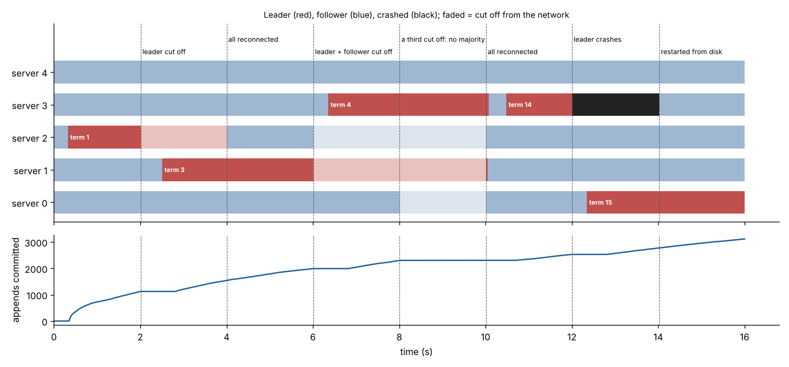
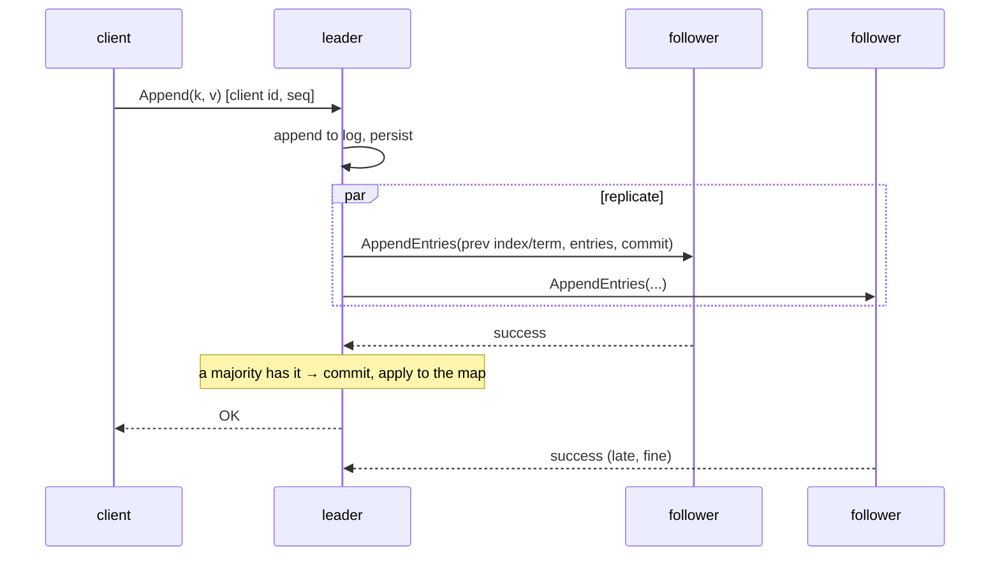

# raft-kv

The Raft consensus algorithm in Go, with a replicated key-value store on top, tested against a
network that drops, delays and partitions messages and crashes servers. Correctness isn't judged
by eye: every run records the clients' operation history, and a linearizability checker
(also implemented here) proves that the history is equivalent to a single, correct copy of the
data.



Five servers running through scripted failures, while a client appends as fast as the cluster
allows. Commits pause only while there is no leader or no majority. Between 8 s and 10 s, *two*
servers believe they are leader: server 3 of term 4, and server 1, cut off since 6 s, of term 3.
Raft allows that, since there is at most one leader per term, and neither can commit anything,
because neither can reach a majority.

## What's in it

| package | contents |
|---|---|
| [`raft`](raft/raft.go) | leader election with randomised timeouts, log replication, the commitment rule for earlier terms (§5.4.2), fast log backup using conflict hints, persistence of `currentTerm`, `votedFor` and the log |
| [`kv`](kv/server.go) | a key-value store (`Get`, `Put`, `Append`) whose every operation, reads included, goes through the log; clients retry freely because servers apply each (client, sequence number) at most once |
| [`linz`](linz/linz.go) | a linearizability checker: Wing & Gong's search with Lowe's memoisation, checking each key independently |
| [`labnet`](labnet/labnet.go) | an in-process network with message loss, random delays, partitions and crashes |
| [`cmd/demo`](cmd/demo/main.go) | the failure timeline above, and a throughput benchmark |



## How correctness is tested

**Raft (12 tests).** Each test runs a cluster through a scenario:
- elections: initial, after a leader failure, with no quorum, and many in a 7-server cluster;
- agreement: basic, with failed followers, without a majority, and over a lossy network;
- a deposed leader rejoining with conflicting entries;
- fast backup over 50-entry conflicting logs;
- crash and restart from persisted state;
- concurrent `Start` calls;
- an unreliable-network version of the paper's Figure 8 scenario.

Throughout, the harness checks two properties on every single apply: no two servers ever commit
different commands at the same index (State Machine Safety), and entries are applied in order.

**The key-value store (6 tests).** Five clients run random `Get`/`Put`/`Append` operations on three
keys while a "nemesis" attacks the cluster. Every operation's real-time call and return is
recorded, and the checker must find a valid linearization:

| scenario | operations checked | result |
|---|---:|---|
| reliable network, 3 s | 1,600 | linearizable |
| random minority isolated every 400 ms, 10 % message loss, 5 s | 271 | linearizable |
| random servers crashed and restarted from disk every 500 ms, 5 s | 2,507 | linearizable |
| **negative control:** replicas answer `Get` from their own state, skipping the log | — | **rejected, as it should be** |

The negative control matters. Without it, a checker that accepted everything would look exactly
like a correct system. The checker has its own tests too: stale reads, reads going back in time,
lost appends, and two readers seeing concurrent appends in different orders are all caught.

Everything passes under Go's race detector (`go test -race ./...`).

## A bug the timeline caught

The first timeline showed commits stalling for about 0.8 s *before* any failure. The cause was in
the key-value server. It called `raft.Start()` and only *then* registered the channel on which to
wait for the result. On this fast in-process network the entry could commit and be applied in
between, so the result went to nobody and the client sat out its full 800 ms timeout.
The linearizability tests didn't catch it, because the client's retry is answered correctly
from the duplicate table: it was a liveness bug, not a safety one. Registering the waiter under the
same lock as `Start()` fixed it, and single-client throughput went from 475 to 688 operations per
second.

## Throughput

On the in-process network (no simulated latency), 3 s per run, `go run ./cmd/demo -mode bench`:

| servers | clients | operations/s | median latency | p99 |
|---:|---:|---:|---:|---:|
| 3 | 1 | 688 | 1.4 ms | 4.5 ms |
| 3 | 8 | 700 | 10.7 ms | 34 ms |
| 5 | 1 | 517 | 2.0 ms | 5.3 ms |
| 5 | 8 | 652 | 11.3 ms | 40 ms |

These measure the implementation's own costs, not a network. They are also held back by a
deliberate simplification: `persist()` re-encodes the *whole* log on every change, so each append
costs time proportional to the log's length. You can see the commit rate in the timeline slowly
falling. A real system appends to a write-ahead log and takes snapshots.

## Run it

```bash
go test ./...                 # about 65 s
go test -race ./...
go run ./cmd/demo -mode timeline > docs/timeline.csv && python3 scripts/plot_timeline.py
go run ./cmd/demo -mode bench
```

## Limits

- No log compaction or snapshots (§7 of the paper), and no cluster membership changes (§6).
- Persistence re-encodes the whole log each time (see above).
- The simulated network isolates individual servers. It can't split the cluster into two
  internally connected halves.
- Reads go through the log. Raft's read-index or lease optimisations aren't implemented.

## References

- D. Ongaro, J. Ousterhout, *In Search of an Understandable Consensus Algorithm*, USENIX ATC (2014).
- M. Herlihy, J. Wing, *Linearizability: A Correctness Condition for Concurrent Objects*, ACM TOPLAS 12 (1990).
- J. M. Wing, C. Gong, *Testing and Verifying Concurrent Objects*, J. Parallel Distrib. Comput. 17 (1993).
- G. Lowe, *Testing for Linearizability*, Concurrency and Computation 29 (2017).
- The test scenarios are modelled on MIT 6.824's Raft labs; the code here is written from the paper.

## License

MIT
